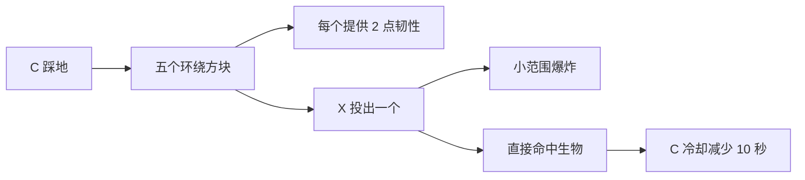

# 有套装与压缩采掘装备

“有”套装四个部位均名为“有”。基础护甲、耐久和击退抗性与压缩下界合金套装相同，每件提供 20 点最大生命；胸甲、护腿各额外提供 2 点护甲韧性。四个正确部位全部穿戴时开放套装技能。

| 操作 | 效果 |
| --- | --- |
| C | 踩地，动作期间锁定移动；刷新五个灰色环绕方块。两格内的非同队生物获得破甲 II、噬心 II，各持续 10 秒。冷却 55 秒。 |
| X | 随机播放两种投掷动作之一，投出一个环绕方块；凋灵头大小的爆炸造成 150 点基础伤害，遮挡和护甲仍参与伤害结算。直接命中生物减少 C 冷却 10 秒，爆炸溅射不减少冷却。 |
| Z | 在狂暴、中立两种活方块模式之间切换，当前模式持续显示在左下角。 |
| 潜行 + Z | 将主手持有的方块唤醒为活方块；前方须有生成空间，不可破坏的方块不能唤醒。 |

活方块沿原版导航和碰撞规则滚动追击。狂暴模式主动寻找敌人；中立模式响应主人攻击、主人受伤或自身受袭。活方块存在期间预留主人的最大生命，死亡后归还预留值，不额外治疗当前生命。主人死亡、脱下任一套装部件或与方块分处不同维度时，召唤契约终止；卸载区块和退出游戏不会重复扣除或返还最大生命。

| 方块硬度 | 生命 | 攻击 | 预留最大生命 |
| --- | ---: | ---: | ---: |
| 小于 3 | 300 | 30 | 2 |
| 等于 3 | 2000 | 100 | 5 |
| 大于 3 | 5000 | 150，忽略目标 10% 护甲 | 8 |

套装在锻造台使用高级锻造模板、对应部位的压缩下界合金护甲和灰色混凝土升级获得。

## 压缩镐与斧

铜、铁、金、钻石压缩镐斧在机械工作台使用对应压缩材料和木棍，按原版工具形状合成。下界合金压缩工具由对应钻石压缩工具、下界合金升级模板和压缩下界合金锭锻造。

| 材料 | 耐久 | 镐伤害 | 镐采掘等级 | 镐速度 | 斧伤害 | 斧速度 |
| --- | ---: | ---: | --- | ---: | ---: | ---: |
| 铜 | 1000 | 6 | 铁 | 7.5 | 18 | 6 |
| 铁 | 1500 | 9 | 钻石 | 8.5 | 30 | 12 |
| 金 | 1000 | 6 | 铁 | 12 | 35 | 12 |
| 钻石 | 5000 | 12 | 钻石 | 9 | 78 | 14 |
| 下界合金 | 9000 | 15 | 钻石 | 11 | 130 | 9 |

铜压缩斧的满蓄力暴击倍率为 2；其他工具沿用原版暴击规则。表中伤害包含玩家基础攻击力，不包含附魔、效果、护甲或暴击。
